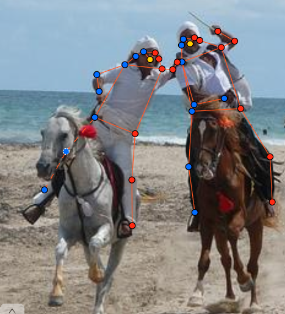
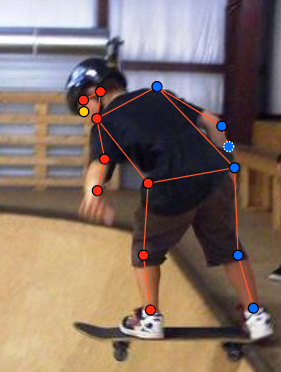
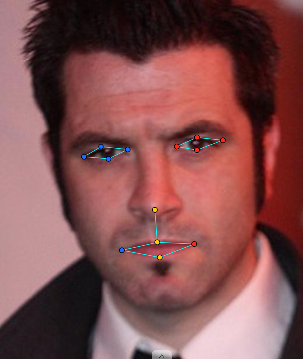
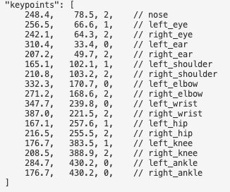

# Báo cáo cá nhân — HuynhNgocGiaHan-2A202603128

Dữ liệu: 12 ảnh người COCO val2017 (Lin et al., 2014) và 8 ảnh chân dung Wikimedia Commons, chỉ dùng trong lớp.

## 0. Thông tin học viên

- Họ tên: Huynh Ngoc Gia Han
- MSSV: 2A202603128
- Email: huynh.han.ctc@gmail.com
- Link repository: https://github.com/suadaunanh/K5-L2-DAY04-HuynhNgocGiaHan-2A202603128-KeypointPose
- Phiên bản CVAT (Help → About): 2.74.1
- Máy: hệ điều hành macOS 27.0.1 · RAM 24 GB (Docker được cấp 7.7 GB) · chạy CVAT chế độ đầy đủ
- Bộ ảnh (`src/exports/assignment.json` do `lab.py setup` tạo): có
- Giờ bắt đầu: 17:00 
- Giờ kết thúc: 23:00

## 1. Kiểm tra label (CP0)

| Label | Kiểu | Số điểm | Tên điểm đúng bảng của lab? | Đúng thứ tự? | Số cạnh |
|---|---|---:|---|---|---:|
| `person` | Skeleton | 17 | Có | Có | 19 |
| `face` | Skeleton | 13 | Có | Có | 13 |

(Số điểm và số cạnh đối chiếu trong `categories` của file xuất; script tự kiểm không báo lỗi tên hay thứ tự.)

Mẫu `person` dựng theo người quay mặt về camera (các điểm `left_*` nằm bên phải khung mẫu)? Có

Cách đổi cờ `occluded` / `outside` cho **một điểm** trên phiên bản CVAT này (một câu):

Rê chuột vào đúng điểm cho đến khi điểm sáng lên rồi bấm `Q` (occluded) hoặc `O` (outside), hoặc chuột phải vào điểm và chọn nút tương ứng; bấm lại lần nữa để tắt cờ.

## 2. Số lượng đã gán và thời gian (CP1, CP2)

| Nhóm ảnh | Số ảnh | Số skeleton đã gán | Số người dưới 60 px (không gán) | Số poster / gương / màn hình bỏ qua | Thời gian (phút) |
|---|---:|---:|---:|---:|---:|
| `easy` | 5 | 5 | 0 | 0 | 30 |
| `occluded` | 3 | 5 | 0 | 0 | 30 |
| `back` | 2 | 4 | 0 | 0 | 25 |
| `small` | 1 | 2 | 0 | 0 | 15 |
| `crowd` | 1 | 3 | 0 | 0 | 20 |
| `faces` | 8 | 8 | — | 0 | 120 |

(Thời gian từng nhóm ảnh người là ước lượng, chia 120 phút của CP1 theo số skeleton mỗi nhóm.)

- Số ảnh người đã xong ở mốc phút 105: ___ / 10
- Thời gian thực tế (phút): CP1 120 · CP2 120 · CP3 120
- Ảnh tốn thời gian nhất là ảnh nào, vì sao?

`000000022857.jpg` (nhóm `back`, nhà bếp). Ảnh có hai người: anh đứng quay lưng ở mép trái bị khung ảnh cắt mất nửa người, và anh đầu bếp đứng nghiêng. Ở anh quay lưng, hông trái nằm đúng trên mép ảnh và lúc đầu tôi để `v = 2`, nên script báo lỗi. Ở anh đầu bếp, tôi đặt vai, hông và gối hai bên ở hai mép thân (lưng và bụng), trong khi khi đứng nghiêng các khớp này gần như chồng lên nhau ở giữa thân. Tôi phải sửa vị trí nhiều lần, có lần còn kéo nhầm khung bao làm co cả skeleton và phải `Ctrl+Z`.

## 3. Bảng ca khó (CP1, CP2)

| Ảnh | Người / mặt | Điểm | Cờ đã chọn | Phân vân giữa | Lý do chọn |
|---|---|---|---:|---|---|
| `000000022857.jpg` | anh đầu bếp (đứng nghiêng, nhìn sang phải ảnh) | `left_hip`, `left_shoulder`, `left_knee` | 1 | 1 / 0 | Bên trái ở phía xa camera, bị chính thân che (tự che). Vị trí ước lượng chắc vì nằm ngay sau `right_*` tương ứng, nên chọn `v = 1` theo guideline |
| `000000022857.jpg` | anh đầu bếp | `right_hip` | 2 | 2 / 1 | Hông phía gần camera, chỉ có tạp dề phủ ngoài. Guideline: thấy được khớp dưới quần áo thì `v = 2` |
| `000000122199.jpg` | anh áo xám phía sau | `left_shoulder` | 0 | 2 (kéo vào trong) / 0 | Vai trái nằm đúng mép phải ảnh, phần vai bị khung cắt. Không chắc khớp còn trong ảnh nên chọn `outside` thay vì kéo điểm về mép |
| `000000056651.jpg` | chị áo hồng (nhìn sang trái ảnh) | `left_ear` | 0 | 1 / 0 | Tai nằm ở mép phải ảnh, bị tóc và khung ảnh che, không đoán được vị trí chắc chắn |
| `face_99874.jpg` | mặt đeo kính râm | 8 điểm mắt | 1 | 2 / 1 | Kính râm tối che mắt. Guideline: đặt sau tròng kính theo gọng, `occluded` |

## 4. Bảng tự review (CP3)

| Ảnh | Người / mặt | Điểm | Mã lỗi | Ghi chú | Đã sửa? |
|---|---|---|---|---|---|
| `000000431988.jpg` (`back`) | cậu bé áo xanh phía sau | `left_wrist` | `vis_flag` | `v = 2` nhưng nằm ngoài mép phải (x = 375); tay trái bị khung ảnh cắt → `outside` | Có |
| `000000431988.jpg` (`back`) | cậu bé áo xanh phía sau | `left_elbow` | `vis_flag` | `v = 2`, sát mép phải (cảnh báo); cùng tay bị cắt → `outside` | Có |
| `000000022857.jpg` (`back`) | anh quay lưng ở mép trái | `left_hip` | `vis_flag` | `v = 2` tại x = −0 (ngoài mép trái) → `outside` | Có |
| `000000022857.jpg` (`back`) | anh đầu bếp | hai hông, hai gối, hai vai | `position` | Đặt ở hai mép thân (lưng/bụng) thay vì vào tâm khớp; người đứng nghiêng nên kéo hai bên lại sát nhau | Có |
| `000000022857.jpg` (`back`) | anh đầu bếp | `left_shoulder`, `left_hip` | `vis_flag` | Lỡ bấm `O` thành `v = 0`; khớp có thật, bị thân che → bật lại, `v = 1` | Có |
| `000000122199.jpg` (`occluded`) | anh áo xám phía sau | `left_shoulder` | `vis_flag` | `v = 2` tại x = 482, ngoài mép phải ảnh (rộng ~480 px) → `outside` | Có |
| `000000056651.jpg` (`occluded`) | chị áo hồng | `left_ear` | `vis_flag` | `v = 2` tại x = 640, ngoài mép phải → `outside` | Có |
| `000000056651.jpg` (`occluded`) | chị áo hồng | cặp `wrist` | `ok` | Script cảnh báo cặp cổ tay ngược phía. Kiểm lại: tay trái (gần camera) đỡ đáy khay, tay phải giữ góc trên khay, tư thế thật, không phải đổi bên | — |
| `000000056651.jpg` (`occluded`) | cô áo sọc | `left_wrist`, `right_wrist` | `vis_flag` | Đang `v = 0` nhưng hai bàn tay chắp ở bụng, dưới đĩa bánh, vẫn nhìn thấy được; nên là `v = 2` (hoặc `v = 1` nếu bị đĩa che một phần) | Chưa |
| `000000326480.jpg` (`crowd`) | ___ | ___ | ___ | ___ | ___ |
| `face_99874.jpg` | mặt đeo kính râm | 8 điểm mắt | `vis_flag` | Lúc đầu cả 13 điểm `v = 2`; mắt nằm sau kính râm tối → 8 điểm mắt chuyển `v = 1` | Có |
| `face_514826.jpg` | mặt đeo kính trong | 13 điểm | `ok` | Kính trong, mắt nhìn thấy: 13 điểm `v = 2` đúng guideline | — |
| `face_562485.jpg` | mặt có tóc che | 13 điểm | `ok` | Tóc lòa xòa nhưng vẫn thấy các điểm: 13 điểm `v = 2` | — |

Tổng hợp số lỗi theo mã:

| `lr_swap` | `vis_flag` | `position` | `missing` | `extra` | `ok` |
|---:|---:|---:|---:|---:|---:|
| 0 | 8 | 1 | 0 | 0 | 3 |

Điểm còn phân vân giữa `v = 1` và `v = 0` (ghi cả hai lựa chọn và lý do chọn):

- `000000056651.jpg`, chị áo hồng, `left_ear`: nếu chọn `v = 1` thì phải đoán tai nằm sau tóc, sát mép ảnh; chọn `v = 0` vì vị trí có thể lệch nhiều (ba người ước lượng sẽ tản mát).
- `000000122199.jpg`, anh áo xám, `left_shoulder`: nếu giữ khớp trong ảnh thì phải kéo điểm vào trong mép vài px (`v = 2`); chọn `v = 0` vì không chắc phần vai còn nằm trong khung.

## 5. Kiểm file xuất và kết quả tự kiểm (CP4)

Tự kiểm tay trong file JSON:

| File | Người / mặt kiểm (ảnh, thứ tự) | Số phần tử `keypoints` | Điểm `outside` ra `v = 0`, `occluded` ra `v = 1`? | `num_keypoints` khớp? |
|---|---|---:|---|---|
| `HuynhNgocGiaHan_persons.zip` | `000000022857.jpg`, annotation id 4 (anh đầu bếp) | 51 | Có: `left_ear`, `left_elbow`, `left_wrist`, hai cổ chân là `0`; `left_eye`, `left_shoulder`, `left_hip`, `left_knee` là `1` | Có (12 điểm `v > 0`, `num_keypoints = 12`) |
| `HuynhNgocGiaHan_persons.zip` | `000000056651.jpg`, annotation id 6 (chị áo hồng) | 51 | Có: `left_ear` và các điểm bị cắt là `0`; vai phải, khuỷu phải, hông phải là `1` | Có (10 / 10) |
| `HuynhNgocGiaHan_faces.zip` | `face_99874.jpg`, annotation id 8 (kính râm) | 39 | Có: 8 điểm mắt `1`, mũi và miệng `2` | Có (13 / 13) |

Sau khi xuất, CVAT ghi `occluded` thành `v = 1` và `outside` thành `v = 0`. Tọa độ của điểm `outside` trong file là `0, 0` hay tọa độ cũ? Tọa độ cũ (ví dụ `left_ear` của anh đầu bếp ghi `310.4, 33.4, 0`).

Hai job đã chuyển sang completed trên CVAT? ___

Dán phần **TÓM TẮT** in ra từ `src/check_submission.py`:

```text
----- TÓM TẮT (dán vào báo cáo mục 5) -----
- File person: HuynhNgocGiaHan_persons.zip
  Số ảnh: 12 · số skeleton `person`: 19 · mỗi annotation 51 số
  Skeleton theo ảnh: 000000007281=2, 000000021235=1, 000000022857=2, 000000056651=2, 000000122199=2, 000000183176=1, 000000211458=1, 000000294329=1, 000000326480=3, 000000336477=1, 000000429594=1, 000000431988=2
  Cờ v: v=2 257 (80%) · v=1 16 (5%) · v=0 50 (15%)
  num_keypoints trung bình: 14.4
- File face: HuynhNgocGiaHan_faces.zip
  Số ảnh: 8 · số skeleton `face`: 8 · mỗi annotation 39 số
  Skeleton theo ảnh: face_137371=1, face_147624=1, face_261458=1, face_436791=1, face_514826=1, face_562485=1, face_92028=1, face_99874=1
  Cờ v: v=2 96 (92%) · v=1 8 (8%) · v=0 0 (0%)
  num_keypoints trung bình: 13.0
- Ghi chú: 50 điểm v = 0 vẫn mang tọa độ cũ (CVAT 2.x xuất như vậy; chuẩn COCO ghi 0, 0). Không phải lỗi: điểm v = 0 bị bỏ qua khi huấn luyện và khi chấm.
- Số [LỖI]: 0 · số [CẢNH BÁO]: 2
Kết quả: ĐẠT (đọc lại từng cảnh báo ở trên)
```

Lần chạy đầu tiên có 4 `[LỖI]` (4 điểm `v = 2` nằm ngoài ảnh) và 3 `[CẢNH BÁO]`; đã sửa trên CVAT và xuất lại.

Các `[CẢNH BÁO]` còn giữ nguyên và lý do:

1. `000000056651.jpg #1: cặp wrist nằm ngược phía so với các cặp còn lại`. Giữ nguyên: đã kiểm, đây là tư thế thật (chị đưa tay gần camera ra đỡ đáy khay, tay xa giữ góc trên khay), không phải đổi trái/phải.
2. `000000056651.jpg #1: left_hip v = 2 nằm sát mép ảnh (639, 503)`. Chị áo hồng đứng nghiêng, thân bị mép phải ảnh cắt. Điểm hông đang nằm ở mép lưng (sát mép ảnh); đúng ra khớp hông nằm vào giữa thân, nên vị trí này còn lệch (`position`) và chưa kịp sửa.

## 6. Ảnh chụp màn hình

1. Label `person` trong label constructor (đủ 17 điểm có tên):

   

2. Một người quay lưng đã gán, cờ đã đặt:

   

3. Một khuôn mặt đã gán 13 điểm, phóng to vùng mắt:

   

4. Một đoạn JSON xuất của một người:

   

Nguồn ảnh: COCO val2017 / Wikimedia Commons.

## 7. Tự đánh giá

1. Lỗi bạn mắc nhiều nhất hôm nay, và cách bạn sẽ tránh ở dự án thật:

   Lỗi nhiều nhất là `vis_flag` cho điểm ở mép ảnh: khớp bị khung cắt nhưng tôi vẫn kéo điểm về sát mép và để `v = 2` (4 lỗi đầu tiên script báo đều là loại này). Lỗi thứ hai là `position` với người đứng nghiêng: tôi đặt hai hông, hai vai ở hai mép thân thay vì vào tâm khớp. Ở dự án thật tôi sẽ: (1) trước khi đặt điểm, kiểm từng người xem có bị khung cắt không, khớp nào ngoài ảnh thì bấm `O` ngay; (2) với người nghiêng, đặt khớp phía gần camera trước rồi đặt khớp phía xa ngay sau nó với `v = 1`; (3) chạy script tự kiểm sau mỗi vài ảnh thay vì đợi cuối buổi.

2. Một quy tắc bạn đề xuất thêm vào guideline (kèm ảnh ví dụ nếu có):

   "Người đứng nghiêng hẳn: hai vai, hai hông, hai gối gần như chồng lên nhau trên ảnh, nằm bên trong thân, không đặt ở viền lưng và viền bụng. Khớp phía gần camera `v = 2`, khớp phía xa đặt sát sau nó, `v = 1`." Ví dụ: anh đầu bếp trong `000000022857.jpg`.

3. Nhãn của bạn đi vào model ở đâu? Chọn một lỗi bạn đã sửa và nói nó sẽ làm model học sai thế nào (heatmap, trọng số trong loss, hay bước lật ảnh):

   Lỗi `left_hip` của người ở mép trái `000000022857.jpg` để `v = 2` tại x ≈ 0. Với `v = 2`, điểm có trọng số 1 trong loss và tạo một đỉnh Gauss trên heatmap đích ngay sát mép ảnh. Model sẽ bị dạy rằng khi một người bị khung cắt thì hông nằm ở mép ảnh, tức là học đoán khớp "dính" vào biên thay vì không trả về điểm. Khi lật ảnh để tăng dữ liệu, điểm này chuyển sang mép phải và đổi tên thành `right_hip`, nên lỗi bị nhân đôi. Đổi thành `v = 0` thì trọng số bằng 0 và model không bị phạt ở khớp đó. Tương tự, đặt hông của anh đầu bếp ở mép thân làm đỉnh heatmap lệch vài chục px so với khớp thật.

## 8. Khó khăn và lỗi kỹ thuật

- `git clone` link trong README báo "Repository not found" (repo đề bài thực tế là `K5-L2-KeypointPose-Student`); tôi dùng bản ZIP tải về, sau đó fork.
- macOS không có lệnh `python`, phải dùng `python3`.
- Dán nhầm sơ đồ cây thư mục và nội dung JSON vào terminal (báo `command not found` / `parse error`); một lần copy lệnh dính ký tự ẩn `​`.
- Kéo nhầm góc khung bao của skeleton làm co toàn bộ các điểm; phải `Ctrl+Z`.
- Chạy lại `lab.py setup --bonus` tạo thêm 2 task `persons` / `faces` mới (task 4, 5) trống, trong khi nhãn nằm ở task 2, 3. File zip nộp là bản xuất từ task 2, 3 trước đó; tôi không chạy lại `lab.py export` để tránh ghi đè bằng file rỗng.
- `git push` bị từ chối vì repo GitHub đã có ảnh tải lên qua web và lịch sử không chung gốc; phải lấy lại ảnh rồi `push --force`.

## Bonus (nếu làm)

Không làm. (Đã chạy `setup --bonus` nên CVAT có task `persons-extra` / `faces-extra` nhưng chưa gán.)

## 9. Tài liệu tham khảo và công cụ AI đã dùng

- `docs/GUIDELINE.md`, `docs/CVAT_CHEATSHEET.md`, `docs/COCO_KEYPOINTS.md`, `SUBMISSION.md` của repo lab.
- Claude Code (trợ lý AI): đọc kết quả `src/check_submission.py`, chỉ ra vị trí điểm lỗi trên ảnh chụp màn hình CVAT, gợi ý cách đặt khớp cho người đứng nghiêng, hướng dẫn các lệnh git, và soạn nháp báo cáo này từ dữ liệu file xuất. Tôi tự gán và sửa nhãn trên CVAT, và đã đọc lại báo cáo.
